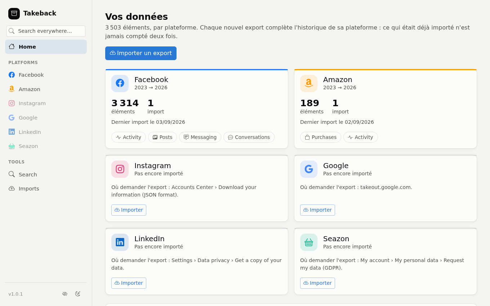
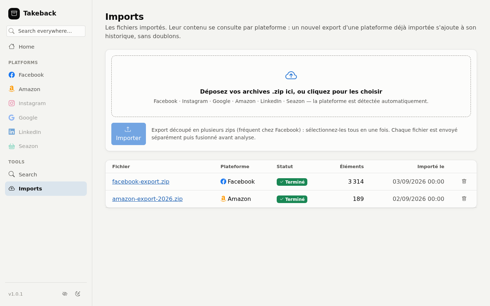
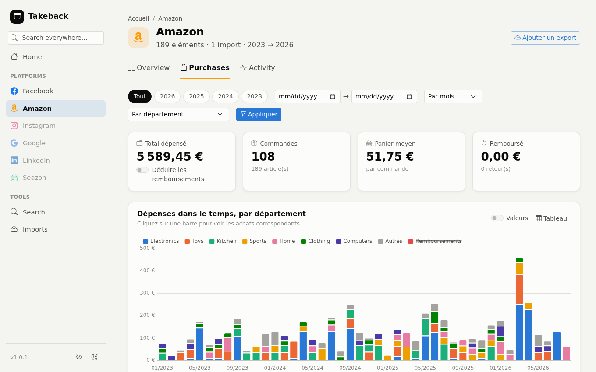
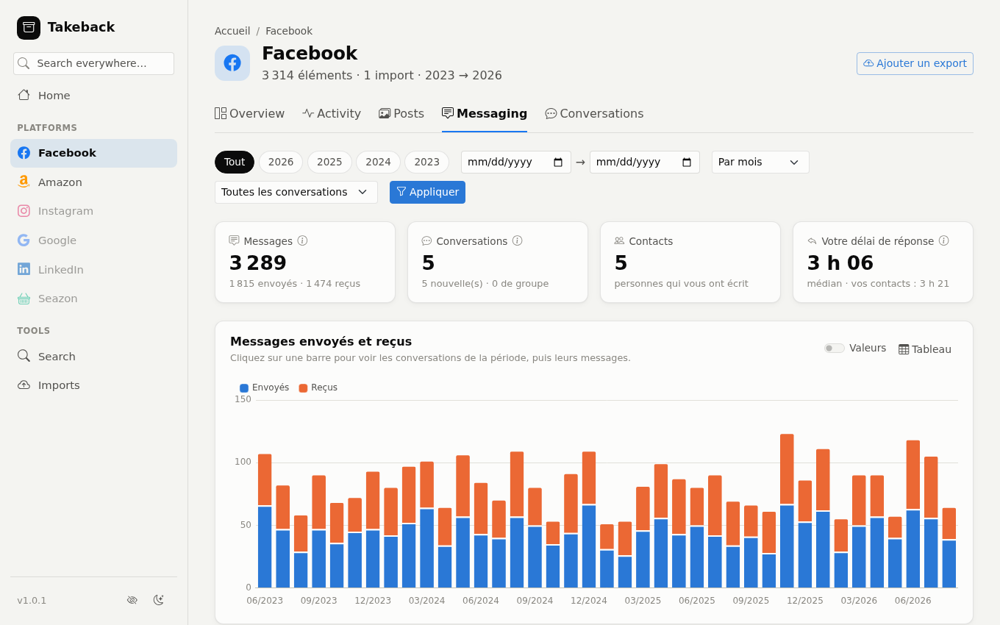

# Takeback – personal data archive

Import, parse and browse the "download your data" exports the platforms give
you (Facebook, Instagram, Google Takeout, Amazon, LinkedIn, Seazon, Zalando, and
more to come) — a single self-hosted app.

## Scope

Takeback reads the **"Download your data" archives** platforms provide, turns
them into a clean, de-duplicated history per platform you can browse in the app
and, **optionally**, pushes numbers drawn from that data into InfluxDB so you
can cross them with everything else in Grafana ([InfluxDB
export](#influxdb-export-grafana)). Without InfluxDB the app is complete.

Takeback calls no service's API (no live sync, no stored platform credentials),
does not gather data from other tools, and does no analysis of its own: that is
Grafana's job.

Where a new source goes:

| The source is... | It goes... | Examples |
|---|---|---|
| a platform's whole "your data" archive: many categories, text, made to be browsed | into Takeback, as an import module | Meta, Google Takeout, Amazon (Kindle and Audible included), LinkedIn, Seazon, Zalando, the Spotify export |
| measurements to plot or cross-reference, from the source's API and/or its export file | into a dedicated sync tool, which writes to InfluxDB | Renpho, Whoop, MyTherapy, MyFitnessPal, Audiobookshelf (see [Tributary](https://github.com/vchatela-org/tributary)) |
| a tool that already has its own storage and interface | nowhere: it stays as it is | garmin-grafana, Tautulli, Your Spotify |

Manual or automatic is not the dividing line, only how data arrives; three
rules settle the rest:

1. **One writer per series.** A source with an API and a richer export goes
   entirely through the same tool: both fill the same series and must be
   merged. A Whoop export therefore ships with the Whoop API, never to
   Takeback.
2. **Takeback sends a measurement only if no dedicated tool provides it.**
   Kindle sessions exist only in Amazon's archive, so Takeback sends them. If
   Amazon ever opened a reading API, the dedicated tool would take over and
   Takeback would stop sending them.
3. **A maintained tool already exists for the source? Use it.** A connector is
   written only for a source that has none.

## Screenshots

Captured from the running app on a synthetic dataset (fake orders and
conversations, no real data).

| | |
|---|---|
|  |  |
| **Home**: one card per platform | **Imports**: drop the `.zip` archives |
|  |  |
| **Amazon**: spending by department over time | **Facebook**: messages sent and received |

## Running it

```bash
# 1. Create a virtual environment
python -m venv .venv
.venv\Scripts\activate        # Windows
# source .venv/bin/activate   # Linux/macOS

# 2. Install dependencies
pip install -r requirements.txt

# 3. (Optional) Copy the config
copy .env.example .env

# 4. Run
uvicorn app.main:app --reload
```

The app is then available on http://localhost:8000
The API documentation (Swagger, not linked from the UI): http://localhost:8000/docs

### Takeback has no login

There is no authentication and no user account: every visitor sees every
imported item. Run it **locally**, or **behind an auth proxy** (Authelia,
Authentik, oauth2-proxy, an nginx `auth_basic` block…) if it listens on
anything but `localhost`. An archive you import is your entire history with a
platform — treat the app as being as sensitive as the exports you feed it.

### Docker

```bash
docker compose up -d
```

The app is then available on http://localhost:8010.
The SQLite database and the extracted exports are persisted in `./data`
(`data/db/`, `data/uploads/`, `data/imports/`).

## Usage

1. On the **Imports** page, drop the `.zip` archive downloaded from Amazon,
   Facebook, Instagram (JSON format), Google Takeout, LinkedIn, Seazon or
   Zalando. For an export split across several zips (common for Facebook on
   large accounts), select them all at once: each file is sent in its own
   request (rather than one multi-gigabyte bundle) via `/imports/start` →
   `/imports/{id}/upload-file` × N → `/imports/{id}/finalize`, so nothing
   depends on a single very large upload that could hit a network limit.
2. The app extracts the archive (every zip merged into one directory),
   detects the matching import module automatically, then parses the content in
   a background job (the status updates live on the import's page).
3. The data is then browsed **by platform** (`/p/amazon`, `/p/facebook`...),
   across every import of that platform: an export imported every year adds to
   the same history, with the same dashboards, rather than opening a new
   analysis per file.

## One platform, several imports (deduplication)

Each export from a platform contains **the account's whole history** up to its
date, not only what changed since the previous one: importing Amazon's 2024
export and then its 2025 one brings every order from before 2024 a second time.
The per-platform views therefore count each item once (`app/dedup.py`):

- every item gets a **fingerprint** computed from its normalised columns (type,
  category, date, title, content, author, context, structured fields) — not from
  the raw JSON, which a later export can enrich with columns without the item
  changing;
- fields that legitimately change from one export to the next for the same item
  (an order's status going "Shipped" → "Closed", a shipping date, a pinned Keep
  note, a LinkedIn contact's current company, an accepted endorsement…) are
  excluded from the fingerprint (`dedup.VOLATILE_FIELDS`), as is the date of an
  item dated by its last occurrence (a LinkedIn Learning course, dated by its
  last view: `dedup.VOLATILE_TIMESTAMP_TYPES`); that list is indexed by **source
  and type** (`dedup.VOLATILE_FIELDS_BY_SOURCE`) because the same type can be
  exported differently per platform: where Amazon writes a complete order as
  soon as it appears, Seazon fills it in over its life (tracking number at
  dispatch, review after delivery, refund after cancellation) — for Seazon only
  the type, the date and the order identifier (`context`) identify the record,
  every other field being left out;
- two strictly identical rows **within one import** remain two items (occurrence
  suffix `:2`, `:3`...): as many copies are kept as the import containing the
  most of them, never the sum;
- among the copies of one item, the one from the most recent import is kept
  (`items.is_duplicate = 0`), the others hidden from the platform views. Deleting
  or re-analysing an import re-elects the kept copies: deleting the 2025 export
  makes those of the 2024 export visible again.

An import still being parsed appears in its platform only once finished
(`is_duplicate` stays `NULL` until then). On the first start after the upgrade,
existing imports are fingerprinted automatically (a catch-up logged at
startup). An import's page says how many of its items appear in no other import,
and `/browse?batch_id=…` still browses one import alone, duplicates included.

## Anonymising an import to share it safely

Once an import has finished, its page offers **Generate an anonymised
version**: the app rebuilds the extracted archive identically (same tree, same
JSON schema) so it stays usable as a realistic test set, but its security model
is a **default deny-list**: every text value is treated as sensitive and
replaced, *except* a handful of technical fields the app itself needs to work:

- **every JSON text field** (name, content, title, description, address and any
  unrecognised field) → replaced by a coherent fake value (one person keeps the
  same fake name throughout the archive); no list of fields to leave alone
  exists — it is the other way round: only `uri` (a media path, rewritten
  coherently) and date fields (shifted by one offset, so chronological order is
  preserved) escape replacement;
- **folder and file names** (conversations, albums, contacts…) → replaced too,
  except the fixed category names specific to Facebook/Instagram/Google
  (`messages`, `inbox`, `Google Photos`...) and the file names import modules
  need to work (`your_posts_1.json`, `message_1.json`, `MyActivity.json`...);
- **unrecognised `.html`/`.txt` files** (common in Google Takeout) → their
  content emptied entirely, as a precaution, rather than partially filtered;
- **`.csv` files** → headers kept (structural), cells replaced; the "Notes:"
  preamble LinkedIn puts before the `Connections.csv` header is kept in its
  shape (the note itself replaced), so that the header stays a header;
- **photos/videos/audio** → replaced by a minimal file.

The result is downloadable (`GET /imports/{id}/anonymize/download`) and can be
shared (support, development, an AI assistant) without exposing your real data.
See `app/anonymize.py`. This "everything is sensitive unless proven otherwise"
model is deliberate: a field the code does not know about must be anonymised by
default, never disclosed by omission.

An individual file that causes trouble (unexpected format, encoding) is emptied
and skipped rather than failing the whole job — on a very large export,
re-running the entire job for one offending file would be costly. If the job
fails anyway, or if files were skipped, the detail (the real error message / the
list of files concerned) is shown directly on the import's page, not only logged
server-side.

## Hiding the screen while sharing it

To share your screen (a call, a demo) without exposing names or messages, the
**crossed-out eye** button at the bottom of the sidebar turns on hiding mode:

- page text (tables, lists and rankings, dates, names) is blurred;
- charts stay sharp so their shape can be shared, but without ticks or values,
  without a legend (series names) and without tooltips;
- data tables, the "Values" / "Table" toggles and opening an item's detail by
  clicking are disabled;
- the detail panel and the search field are blurred.

The sidebar stays usable. The setting is remembered in the browser
(`localStorage`) and survives navigation. It changes no data and does not
replace the export anonymisation above: it is a display-only mask, in the
browser.

## Environment variables

| Variable | Default | Description |
|---|---|---|
| `TAKEBACK_DATABASE_URL` | `sqlite:///./data/db/takeback.db` | Database URL |
| `TAKEBACK_DATA_DIR` | `./data` | Storage root (db / uploads / extracted imports) |
| `TAKEBACK_DEBUG` | `false` | Debug mode |
| `TAKEBACK_LANG` | `fr` | Language the UI is served in when the request asks for none (`fr`, `en`) |
| `TAKEBACK_INFLUXDB_URL` | — | InfluxDB 1.x to feed for Grafana (e.g. `http://influxdb:8086`); without it, no push |
| `TAKEBACK_INFLUXDB_USER` | — | `user` tag of every point (shared-database convention) |
| `TAKEBACK_INFLUXDB_TZ` | `Europe/Paris` | Time zone of the `local_hour` / `local_weekday` fields |
| `TAKEBACK_INFLUXDB_PUSH_HOUR` | `3` | Hour (UTC) of the daily full push |
| `TAKEBACK_INFLUXDB_CREATE_DATABASES` | `true` | Create missing databases (year-long shards) |

## REST API

The API stays available but is no longer surfaced in the interface. Without a
`batch_id`, `/api/items` returns the de-duplicated view (one copy per item, see
above).

| Method | Endpoint | Description |
|---|---|---|
| GET | `/api/imports` | List imports |
| GET | `/api/imports/{id}` | Import detail |
| POST | `/api/imports` | Create an import (multipart upload, one or several merged `.zip`) |
| DELETE | `/api/imports/{id}` | Delete an import and its data |
| POST | `/api/imports/{id}/reanalyze` | Re-run detection + parsing on the files already extracted, without re-uploading |
| POST | `/api/imports/{id}/anonymize` | Start generating an anonymised version |
| GET | `/api/imports/{id}/anonymize` | Anonymisation state (`none`/`building`/`ready`/`error`) |
| GET | `/api/imports/{id}/anonymize/download` | Download the anonymised archive |
| GET | `/api/items` | Paginated search (`source`, `category`, `item_type`, `batch_id`, `q`, `date_from`, `date_to`) |
| GET | `/api/items/{id}` | Item detail (content, structured fields, media, raw JSON) |
| GET | `/api/sync/runs` | Latest pushes (`kind`, `limit`): status, result, counters |
| POST | `/api/sync/{kind}` | Run a configured push right away, in the background: `influxdb` (everything, `source=` one platform rebuilt, `rebuild=true` everything rebuilt) |
| GET | `/api/sync/influxdb/preview` | The points (line protocol) the InfluxDB push would write (`measurement`, `source`, `limit`), even without InfluxDB |

## InfluxDB export (Grafana)

Takeback stays the reference (books, sessions, library, the detail of every
item); Grafana receives enough to plot and **cross-reference** that data with
everything else (sleep, sport, health...). With `TAKEBACK_INFLUXDB_URL`, a push
(`app/sinks/influxdb.py`) writes into InfluxDB 1.x the points
`app/influx_export.py` builds, **one database per domain**:

| Database | Measurement | Items | Tags | Fields |
|---|---|---|---|---|
| `DigitalStats` | `item` | any dated item, all platforms | `source` (= platform), `category`, `item_type` | `count` (i) |
| `MediaStats` | `reading_session` | Kindle and Audible sessions | `source` (`kindle`/`audible`), `kind` (`ebook`/`audiobook`), `device` | `minutes` (f), `sessions` (i), `pages` (i, Kindle), `title` (s) |
| `MediaStats` | `book_finished` | finished Kindle books | `source`, `kind` | `count` (i), `title` (s) |
| `ShoppingStats` | `purchase` | purchase lines (Amazon, Seazon and Zalando orders, digital, Audible) | `source`, `kind` (`retail`/`digital`/`audible`/`meal`/`fashion`), `department`, `currency` | `amount` (f), `lines` (i), `orders` (i) |

On **every** point: the tags `platform` (the Takeback platform), `via=takeback`,
`user` (if configured) and `time_precision` (`second`, or `day` for an item
dated to the day only), and, except for the latter, the fields `local_hour` and
`local_weekday` (1 = Monday) in `TAKEBACK_INFLUXDB_TZ` — InfluxQL cannot convert
a time zone itself; these are what make "evening reading" possible
(`local_hour >= 20 OR local_hour < 3`).

Seazon orders are their own type (`seazon_order`, not Amazon's `order_item`):
they therefore arrive under `kind=meal`, with `department=Repas` (what their
importer names under "Catégorie") and `source=seazon` — enough to separate them
from Amazon in Grafana, `kind` and `source` both being tags. Zalando's are too
(`zalando_order`): they arrive under `kind=fashion`, with `department` set to
the shop the order was placed on ("Zalando" or "Zalando Privé", what its importer
names under "Boutique") and `source=zalando`.

Rules, all covered by `tests/test_influx_export.py`:

- **Privacy**: InfluxDB has no authentication, so Takeback belongs behind a
  login. Only numbers and low-cardinality tags leave; never a message, a
  search, a URL or a name. A text field exists only if a series declares it:
  book titles, nothing else (the test fails otherwise).
- **Fixed types**: InfluxDB 1.x refuses a point whose field changes type; every
  field is declared once (integer, float, text) and an undeclared field is an
  error.
- **Per-second aggregation**: a point is identified by measurement + tags +
  time, so an order's three lines, or two messages in the same second, would
  overwrite each other; they are summed into one point. `orders` counts each
  order once, in the first point holding it: the sum stays exact even for an
  order spanning two categories.
- **Times** are UTC on the way in (as in Takeback); items with no real date and
  duplicates from other imports are left out.

When: **two minutes after every start**, everything is rebuilt (a new version
may have changed a series: no point of the old shape is left); **after every
import, re-analysis or deletion**, for that platform only — its series are
wiped then rewritten, with no stale point; **daily** at
`TAKEBACK_INFLUXDB_PUSH_HOUR` everything is rewritten (a safety net); on demand
from the Imports page ("Push now", "Rebuild"). The wipe touches only
`via=takeback` series: a domain database other tools write to keeps their data
(`MediaStats` also receives, for example, the listening history a sync tool
writes there with `source=audiobookshelf`).
Missing databases are created with **year-long shards**: by default InfluxDB
creates one per week, i.e. 600 for a first push covering a few years; an
existing database is never modified.

The push runs in a background thread of the application (`app/scheduler.py`),
one job at a time, never at startup; every pass is recorded (`SyncRun`) and
shown on the Imports page. The application assumes a single instance (a single
SQLite database): two instances would each push.

### Adding a series

For a new correlation in Grafana: an entry in `SERIES`
(`app/influx_export.py`: database, measurement, item types, tags, fields and
their types), a test, a release. `GET /api/sync/influxdb/preview?measurement=…`
shows the points before any push. A new database also needs its datasource on
the Grafana side (one InfluxQL source per database).

